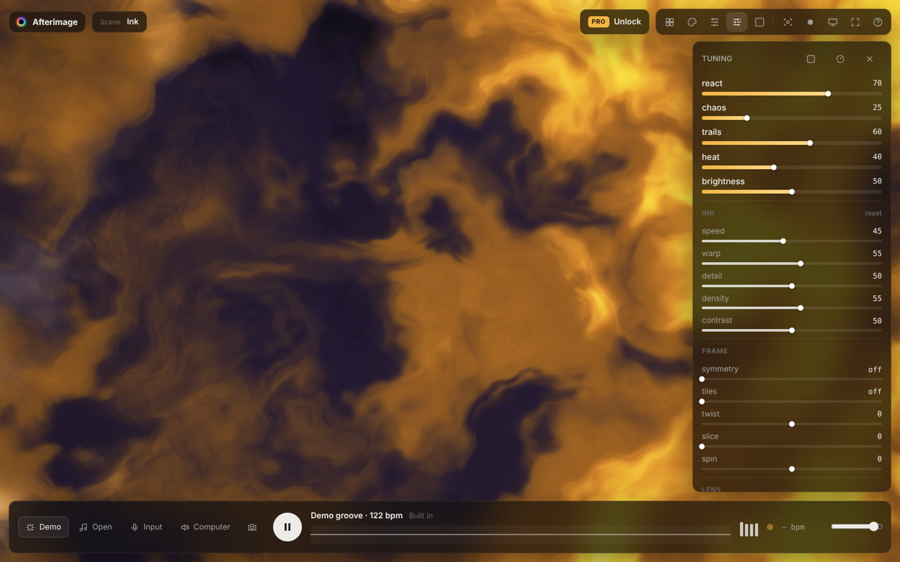
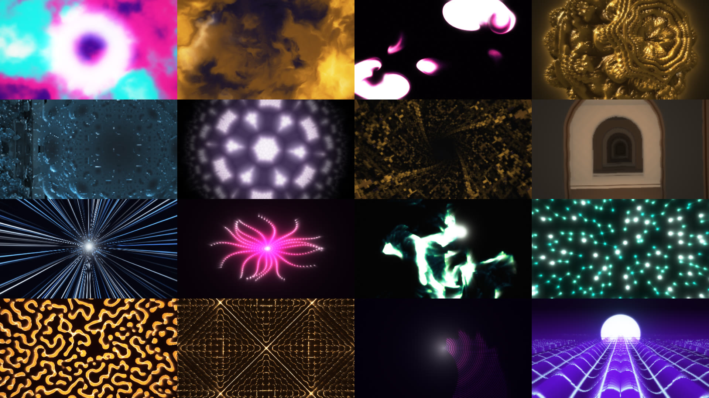
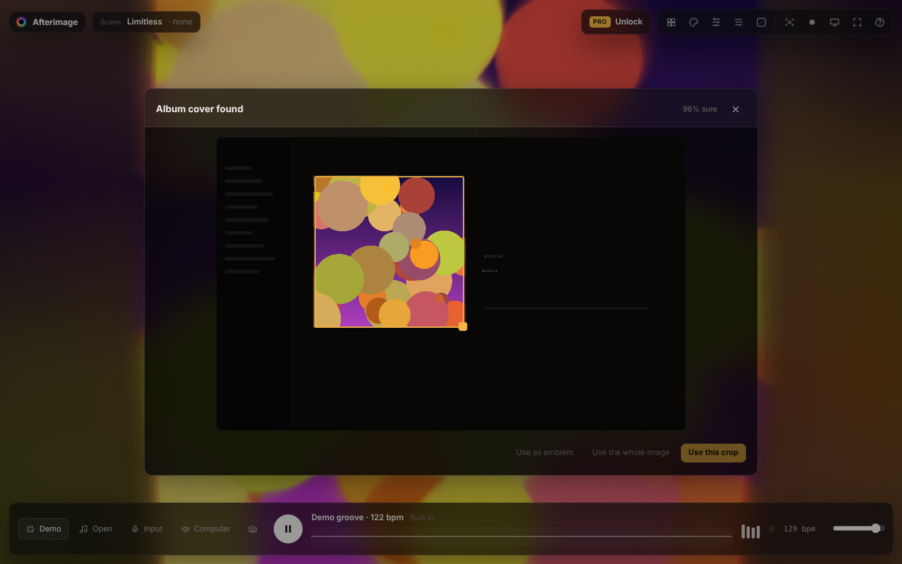
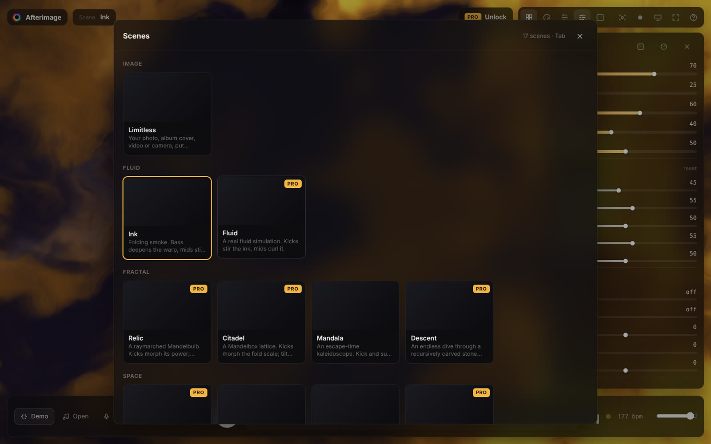

<div align="center">


# Afterimage

**Make the music visible.**

Audio-reactive visuals from any song, photo or album cover, in your browser or as a desktop app for macOS, Windows and Linux.




</div>

Play music and the picture moves with it. Afterimage separates bass, mids and highs and detects kicks, accents and tempo. The analysis drives 17 GPU scenes: fluid simulations, raymarched fractals, particle fields, reaction-diffusion and lab-grade meters.

Drop in a screenshot of Spotify or Apple Music and it finds the album cover, takes the colors from it and builds the visuals around the artwork. Drop a transparent logo and it becomes an emblem that pulses on the beat.

## Highlights

- **Listens to anything**: the desktop app follows whatever your computer is playing (Spotify, YouTube, a DJ app) as soon as it opens. Also works with a mic or audio interface, an audio file, a video's sound, or the built-in demo groove.
- **Album covers found automatically**: a local detector scans screenshots for the most cover-like square, inside a worker so the visuals never stutter. Nothing is uploaded.
- **17 scenes, all real-time GPU**: stable-fluids simulation, Mandelbulb and Mandelbox raymarchers, a 65k-particle curl-noise field, Gray-Scott reaction-diffusion you can paint with the mouse, Chladni plates, spectrogram terrain and more.
- **Five big edits**: react, chaos, trails, heat and brightness. Then frame tricks (symmetry, tiles, twist, slice, spin), seven optical lenses and hue drift.
- **24 palettes**, plus one taken from your image.
- **128 preset slots** with timed morphing between looks. Banks import and export as JSON.
- **Automation lanes**: arm it, play the track and move controls. Your moves replay on every pass and show on the scrubber.
- **MIDI learn**: click a control, turn a knob, done.
- **Record** at 1080p, 1440p or 4K, 30 or 60 fps, in 16:9, 9:16 or 1:1. Saves MP4 with audio, plus PNG stills.
- **Output window** for projectors and second screens, perfect for VJ sets.
- **Keyboard first**: every action is one key away.



## Scenes

| Group | Scenes |
| --- | --- |
| Image | **Limitless**: your photo, cover, video or camera through 22 effect modes (Droste, corridor, planet, shatter, prism, pixel sort, datamosh, halftone, VHS and more) |
| Fluid | **Ink** (folding smoke) · **Fluid** (real fluid simulation; kicks stir it) |
| Fractal | **Relic** (Mandelbulb) · **Citadel** (Mandelbox) · **Mandala** (escape-time kaleidoscope) · **Descent** (endless carved vault, 4 looks) |
| Space | **Gate** (machined arch hall) · **Spacetime** (warp streaks) · **Wisp** (GPU particles) |
| Pattern | **Anemone** (4 modes) · **Synapse** (firing network) · **Morphogen** (reaction-diffusion) · **Sand** (Chladni figures) |
| Signal | **Rings** · **Ridge** (spectrogram terrain) · **Signal** (analyzer, waterfall, scope, goniometer, Lissajous) |

<p align="center"> </p>

## Keyboard

| Key | Action | Key | Action |
| --- | --- | --- | --- |
| `Space` | Play / pause | `L` | Randomize look |
| `Tab` | Scenes | `N` | Random scene |
| `P` | Palettes | `X` | Shuffle everything |
| `E` | Tuning panel | `B` | Swap back |
| `←` `→` | Previous / next scene | `⌘Z` | Undo |
| `↑` `↓` | Previous / next palette | `1`–`9` | Recall preset (`Shift` saves) |
| `C` | Next scene mode | `K` | Preset bank |
| `R` | Record | `S` | Save still |
| `O` | Output window | `F` | Fullscreen |
| `M` | MIDI learn | `H` | Hide interface |
| `D` | Debug overlay | `?` | All shortcuts |

## Getting started

```bash
git clone https://github.com/yuvi1-1/afterimage.git
cd afterimage
npm install
npm run dev        # http://localhost:5173
```

| Command | What it does |
| --- | --- |
| `npm run build` | Static web build in `dist/`. Host it anywhere (Vercel, Netlify, GitHub Pages). |
| `npm run desktop` | Runs the desktop app from the build. |
| `npm run dist` | Installers in `release/`: `.dmg`/`.zip` on macOS, `.exe`/`.zip` on Windows, `.AppImage` on Linux. |

Pushing a tag like `v1.0.0` runs [`release.yml`](.github/workflows/release.yml). It builds the installers for all three platforms and deploys the web app to GitHub Pages.

**Requirements:** a browser with WebGL2 and float render targets (every current desktop browser), and Node 20+ to build.

## How it works

```
audio ──► Web Audio analyser ──► bands · kick · accent · tempo · FFT · waveform · spectrogram
                                          │
image ──► cover detector (worker) ──► crop + 5-colour palette
                                          ▼
          scene shader / simulation ──► HDR trails feedback ──► lens · frame · bloom · grade ──► canvas
                                                                                                  │
                                                         MediaRecorder (MP4) · output window ◄────┘
```

- **Engine** (`src/engine`): a WebGL2 multi-pass renderer. It uses half-float HDR targets and mipmapped feedback for trails, auto-exposure from a 1×1 luma reduction, and adaptive render scale to hold 60 fps.
- **Scenes** (`src/scenes`): each is either a fragment shader implementing `vec3 scene(vec2 p, vec2 uv)`, or a multi-pass `Sim` (fluid, reaction-diffusion, particles) with access to the same audio uniforms and textures.
- **App** (`src/App.tsx`, `src/ui`): React interface, presets, automation, MIDI, recording and licensing.
- **Desktop** (`desktop/main.cjs`): Electron serves the same build from a private `app://` origin. It also grants media/MIDI permissions and captures system audio (WASAPI loopback on Windows, ScreenCaptureKit on macOS 13+).

## Free and Pro

| | Free | Pro |
| --- | :---: | :---: |
| 9 scenes, all palettes, presets, automation | ✓ | ✓ |
| 8 Pro scenes (fluid, fractals, particles, reaction-diffusion) | 20 s preview | ✓ |
| 1080p recording | ✓ | ✓ |
| 1440p and 4K recording | | ✓ |
| Output window, MIDI mapping | | ✓ |

Licenses are offline Ed25519 keys, so there's no server or account to run.

```bash
npm run keygen                                           # once: prints a keypair
# put PUBLIC_KEY in src/lib/license.ts, keep the secret key private
VITE_BUY_URL=https://buy.stripe.com/... VITE_PRICE='$24' npm run build
AFTERIMAGE_SECRET=<secret> npm run sign buyer@email.com  # prints AFTR-… for the buyer
```

Any checkout that can run a webhook (Stripe, Lemon Squeezy, Gumroad) can call the same signing code to send keys automatically.

## macOS note

Release builds made without an Apple Developer ID are unsigned, so macOS calls them "damaged". Clear the quarantine once:

```bash
xattr -cr /Applications/Afterimage.app && codesign --force --deep -s - /Applications/Afterimage.app
```

For public releases, set `CSC_LINK`, `CSC_KEY_PASSWORD`, `APPLE_ID`, `APPLE_APP_SPECIFIC_PASSWORD` and `APPLE_TEAM_ID` in CI to sign and notarize.

## Project layout

```
src/
  engine/     renderer, audio analysis, GLSL, palettes, parameters
  scenes/     17 scenes (shaders + simulations)
  lib/        cover detection, presets, MIDI, recording, automation, licensing
  ui/         panel, transport, sheets, controls
desktop/      Electron main process
scripts/      license key tool
public/       icon, scene thumbnails
```

## Credits

Built by [Yuvraj Pegu](https://github.com/yuvi1-1). Inspired by music visualizers like Photism. All code, shaders, palettes and artwork are original.

© 2026 Yuvraj Pegu. All rights reserved.
